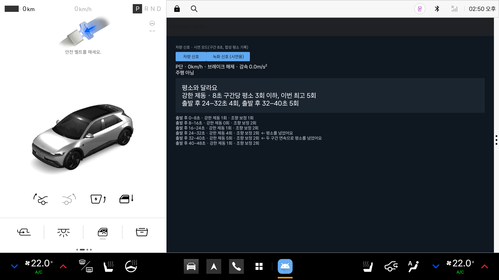

# Pleos 에뮬레이터 신호 확인 기록

확인일 2026-11-10 · Pleos Connect Emulator v2.1.0 (Android 14, arm64) · Vehicle SDK 2.3.2

빈 앱에 Vehicle SDK를 붙여, 에뮬레이터에서 값을 바꿨을 때 앱이 그 변화를 받는지 확인했다. **에뮬레이터에서 확인한 것이며 실차에서 확인한 것이 아니다.**

## 결과

| 신호 | 받는 곳 | 받는 값 | 권한 | 값 변화 수신 |
| --- | --- | --- | --- | --- |
| 기어 | Vehicle SDK `getGear()` | `GEAR_PARK`, `GEAR_DRIVE` 등 | `pleos.car.permission.CAR_DRIVE` | 확인 |
| 차속 | **AAOS `CarPropertyManager`의 `PERF_VEHICLE_SPEED`** | m/s (50km/h → 13.888889), 초당 약 7~10회 | `android.car.permission.CAR_SPEED` | 확인 |
| 브레이크 | Vehicle SDK `getBrake()` | **눌림 여부(Boolean)만** | `pleos.car.permission.CAR_DRIVE` | 확인 |
| 조향 각도 | Vehicle SDK `getSteeringWheel()` | 도(Float), 범위 -470~500 | `pleos.car.permission.CAR_DRIVE` | 확인 |
| 방향지시등 | Vehicle SDK `getTurnSignal()` | `OFF`, `LEFT` 등 | `pleos.car.permission.CAR_LIGHTS` | 확인 |

## 설계에 영향을 주는 점

1. **Vehicle SDK 2.3.2에는 차속 API가 없다.** 차속은 AAOS 표준 Car API로 받는다. `CAR_SPEED`는 실행 중에 사용자가 허용해야 하는 권한이다. Pleos 권한(`pleos.car.permission.*`)은 에뮬레이터에서 설치 시 자동으로 부여됐다.
2. **브레이크는 눌림 여부만 온다.** 페달 압력이나 감속도는 오지 않는다. "강한 제동"은 브레이크가 눌린 동안의 차속 감소율로 앱이 계산해야 한다. 웹 MVP의 시연 기준(감속 4m/s² 이상)을 그대로 쓸 수 있다.
3. **조향 각도의 부호가 Virtual Console 입력과 반대다.** 콘솔에서 +35를 넣으면 앱은 -35를 받는다. 조향 보정 횟수는 변화량으로 세므로 영향이 없지만, 좌우를 구분할 때는 확인이 필요하다.
4. **방향지시등을 받을 수 있다.** 기획서에서 "설계"로 분류한 지표 중 방향지시등은 에뮬레이터에서 신호 수신까지 확인됐다.
5. Vehicle SDK의 `getOdometer()`에 이번 주행의 운전 시간·거리 API가 있다. "쉬지 않고 운전한 시간"에 쓸 수 있는지는 아직 확인하지 않았다.

## 프로젝트 설정

```kotlin
// settings.gradle.kts
maven { url = uri("https://nexus-playground.pleos.ai/repository/maven-releases/") }

// app/build.gradle.kts
android { useLibrary("android.car") }          // 차속용 AAOS Car API
dependencies { implementation("ai.pleos.playground:Vehicle:2.3.2") }
```

```xml
<uses-permission android:name="pleos.car.permission.CAR_DRIVE" />
<uses-permission android:name="pleos.car.permission.CAR_LIGHTS" />
<uses-permission android:name="android.car.permission.CAR_SPEED" />
```

빌드 기준은 공식 샘플 앱과 같게 맞췄다: Gradle 8.10.2, Android Gradle Plugin 8.8.2, Kotlin 2.0.21, compileSdk 35, minSdk 28, JDK 21.

```kotlin
val vehicle = Vehicle(context).also { it.initialize() }
vehicle.getGear().registerGearSelection(object : GearSelectionListener {
    override fun onSelected(gear: VehicleGear?) { /* ... */ }
    override fun onFailed(e: Exception) { /* ... */ }
})

val props = Car.createCar(context).getCarManager(Car.PROPERTY_SERVICE) as CarPropertyManager
props.registerCallback(callback, VehiclePropertyIds.PERF_VEHICLE_SPEED, CarPropertyManager.SENSOR_RATE_NORMAL)
```

`initialize()` 직후에는 차량 서비스 연결이 끝나지 않았을 수 있다. 확인할 때는 2초 뒤에 호출했다.

## 에뮬레이터에서 값 바꾸기

Pleos Virtual Console은 에뮬레이터 안의 웹 화면이다. 브라우저로 열어 손으로 조작하거나, 같은 주소에 요청을 보내 스크립트로 조작할 수 있다. 스크립트로 조작하면 같은 주행을 똑같이 되풀이할 수 있어서 시연 영상과 테스트에 쓸 수 있다.

```sh
adb forward tcp:8088 tcp:8088        # 그다음 http://127.0.0.1:8088/
tools/vconsole.sh drive              # 예시 주행 한 번
```

- 브라우저가 열려 있다는 신호(`POST /browser/session?client=이름`)를 3초 안에 계속 보내야 값 변경이 받아들여진다. 신호가 없으면 `503 emulator_inactive`가 돌아온다.
- 기어: `PUT /vehicle/gear?gear=Drive` (`Park`, `Reverse`, `Neutral`, `Drive`)
- 차속·페달·조향: `PUT /vehicle/controls?speed=50&accelerator=30&brake=0&steering=0` (km/h, %, %, 도)
- 방향지시등: `PUT /vehicle/turn-signal?mode=BlinkLeft` (`Off`로 끔)
- 현재 상태: `GET /vehicle/state`
- 일반 `adb shell cmd car_service inject-vhal-event`는 이 이미지에서 막혀 있다.

이 주소들은 공식 문서에 없고 Virtual Console 화면이 쓰는 것을 읽어서 찾았다. 에뮬레이터 버전이 바뀌면 달라질 수 있다.

## 화면 뒤에서 신호 받기 (2026-11-11 추가)

**액티비티에서 신호를 받으면 주행 중에 받지 못한다.** 기어를 D로 넣으면 시스템이 내비를 화면 앞으로 가져오고, 화면에 없는 앱은 프로세스가 멈춘다(`ActivityManager: freezing`). 차량 서비스는 이벤트를 계속 보내지만 앱에는 닿지 않는다.

**포그라운드 서비스에서 받으면 계속 받는다.** `drivewatch-vehicle`의 `DriveCollectorService`로 옮긴 뒤, 내비가 앞에 있는 동안 48초 주행의 신호를 모두 받았다.

같은 주행을 Virtual Console로 재생해서 수집과 판정이 끝까지 이어지는지 확인했다(`node tools/vconsole-demo.js`).

| 구간 | 보낸 강한 제동 | 앱이 센 횟수 | 판정 |
| --- | ---: | ---: | --- |
| 0–8초 | 1 | 1 | 평소 |
| 8–16초 | 0 | 0 | 평소 |
| 16–24초 | 1 | 1 | 평소 |
| 24–32초 | 4 | 4 | 평소를 넘음 |
| 32–40초 | 5 | 5 | 두 구간 연속, 변화로 기록 |
| 40–48초 | 1 | 1 | 평소 |

주차 후 앱을 열면 카드에 "평소와 달라요 · 강한 제동 · 8초 구간당 평소 3회 이하, 이번 최고 5회"가 뜬다.



## 확인하지 않은 것

- 실차에서의 신호 주기, 단위, 공백.
- 포그라운드 서비스가 Pleos App Market 심사에서 허용되는지.
- 내비 재탐색·회전 안내(NaviHelper SDK), 음성(TextToSpeech SDK).
- `CAR_SPEED` 권한이 Pleos App Market 심사에서 허용되는지.
