# DriveWatch 화면 기획

작성 winter1 · 2026-11-10 · 상태: **팀 확정안** (2026-11-11, 7절 결정)

기준 문서: [drive-watch-final-plan.md](drive-watch-final-plan.md). 기획서의 네 기능(변화 감지 · 생활길 · 운전 약속 · 가족 요약)을 화면 단위로 나눴고, 지금 MVP 코드(`app/`)에 이미 있는 화면과 새로 만들 화면을 표시했다.

---

## 0. 화면 원칙

1. **조작은 P단에서만 한다.** D단에는 화면을 쓰지 않는다. 짧은 음성과 3초 토스트만 쓰고, 한 주행에 최대 2번까지다.
2. **부모님이 먼저 본다.** 모든 요약은 차 화면에 먼저 뜬다. 가족에게 보내는 것은 부모님이 누를 때만 한다.
3. **한 화면에는 결정 하나만 둔다.** 버튼은 최대 2개이고, 글씨는 크게 한다.
4. **위치와 경로는 폰으로 보내지 않는다.** 생활길 구간은 차에만 저장한다.
5. **시연용 입력은 화면에 "시연용"이라고 표기한다.**

## 1. 앱 구성

| 앱 | 누가 | 어디서 | 계정 |
| --- | --- | --- | --- |
| **차량 앱** | 운전하는 부모님 | Pleos 차량 화면 | 차 한 대에 운전자 프로필 여러 개. 상단 탭으로 바꾼다 |
| **자녀 폰 앱** | 가족(자녀) | 휴대폰 | 자녀 한 명이 부모님 프로필 여러 개(엄마 차, 아빠 차)를 연결할 수 있다 |

차량 앱에는 역할 선택이 없다. 차에서 로그인하는 사람은 모두 운전자다.

## 2. 화면 목록

MVP 열: **있음**(지금 코드에 있음), **고침**(있지만 바꿔야 함), **새로**(만들어야 함), **제외**(기획서에만 둠).

### 차량 앱

| ID | 화면 | 언제 | MVP |
| --- | --- | --- | --- |
| C0 | 상단 프로필 바 | 모든 화면 위. 주행 중에는 잠금 | 있음 |
| C1 | 운전자 등록 | 처음, 또는 `+ 운전자 추가` | 있음 |
| C2 | 동의: 기록하는 것과 보내는 것 | 등록 직후 | 새로 |
| C3 | 약속 고르기 | 동의 직후, 이후 홈에서 | 새로 |
| C4 | 가족 초대 코드 | 약속 다음, 또는 홈의 가족 카드 | 있음 |
| C5 | 홈 + 시동 인사 | P단, 시동 직후 | 고침 (인사 배너 추가) |
| C6 | 길 고르기 (빠른 길 / 편한 길) | 표시한 구간이 있는 목적지를 고를 때 | 고침 (근거 문구) |
| C7 | 다른 방법으로 가기 | 시동 인사·길 고르기에서 | 새로 |
| C8 | 주행 중 토스트 | D단 | 있음 |
| C9 | 도착: 한 줄 + 불편했던 곳 표시 | 도착, P단 | 고침 (보내기 → C10으로) |
| C10 | 주간 카드 (부모님 먼저) | 매주 금요일 첫 P단 | 새로 |
| C11 | 운전 기록 상세 (12주) | 홈의 "이번 주 운전" 카드 | 있음 |
| C12 | 설정: 보내는 범위, 연결 끊기, 프로필 삭제 | 홈 | 제외 |
| C13 | 운전 졸업 | 면허 반납 결정 시 | 제외 |

### 자녀 폰 앱

| ID | 화면 | 언제 | MVP |
| --- | --- | --- | --- |
| P1 | 가입 | 처음 | 있음 |
| P2 | 부모님 차와 연결 (코드 / QR) | 가입 직후, `+ 부모님 차 추가` | 있음 |
| P3 | 연결 완료 (학습 기간 안내) | 연결 직후 | 있음 |
| P4 | 가족 목록 + 알림 | 평소 | 있음 |
| P5 | 주간 요약 (상태별 3단계) | 알림을 눌렀을 때 | 고침 (안정 / 관찰 / 대화 권장 차등) |
| P6 | 약속 제안하기 | 요약 화면에서 | 제외 |

## 3. 흐름

**처음 한 번 (연결)**
```
[차] C1 운전자 등록 → C2 동의 → C3 약속 고르기 → C4 초대 코드
                                                  ↕ 코드 / QR
[폰] P1 가입 → P2 코드 입력 ─────────────────────────┘ → P3 연결 완료 → P4
```

**한 번의 이동**
```
C5 홈 (시동 인사) → 목적지 선택 ─┬─ 표시한 구간 있음 → C6 길 고르기 ─┐
        │                        └─ 없음 ───────────────────────────┤
        └→ C7 다른 방법으로 가기                                     ↓
                                        C8 주행 중 (음성만) → C9 도착
```

**매주**
```
C10 주간 카드 (부모님이 먼저 봄) → [가족에게 보내기] → P4 알림 → P5 요약 → 👍 → C5 가족 카드에 표시
```

**운전자 바꾸기**: C0 탭을 누르면 그 운전자의 C5로 간다. 기록, 약속, 연결된 가족은 프로필마다 따로다.

## 4. 화면 이미지

목업 이미지예요. 실제 앱 캡처가 아니에요. 다시 만들려면 `python3 docs/screens/render.py`를 실행하세요(Google Chrome이 필요해요). 설정(C12)과 졸업(C13)은 MVP에서 빼서 그리지 않았어요.

### 차량 앱

**C1 · 운전자 등록**

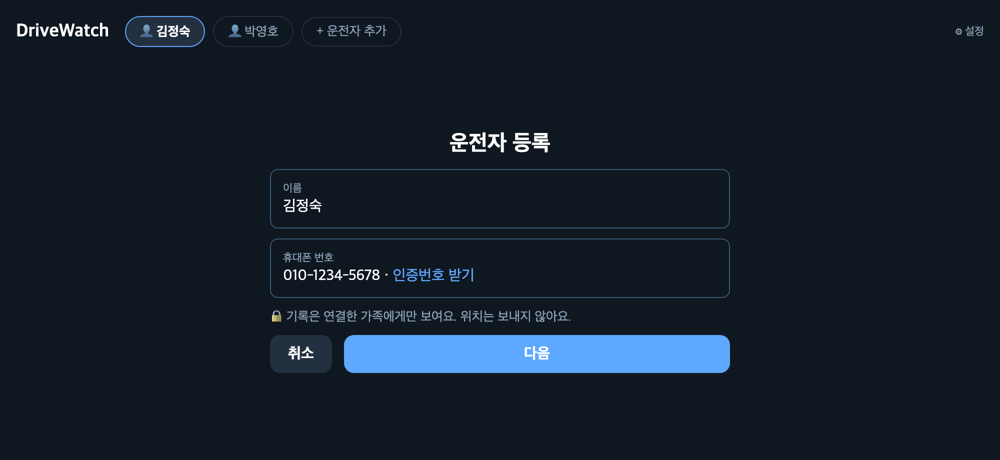

**C2 · 동의: 기록하는 것과 보내는 것**

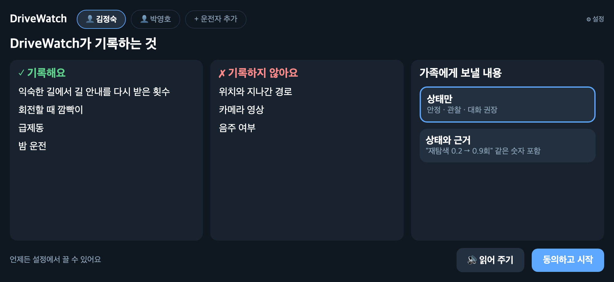

**C3 · 약속 고르기**

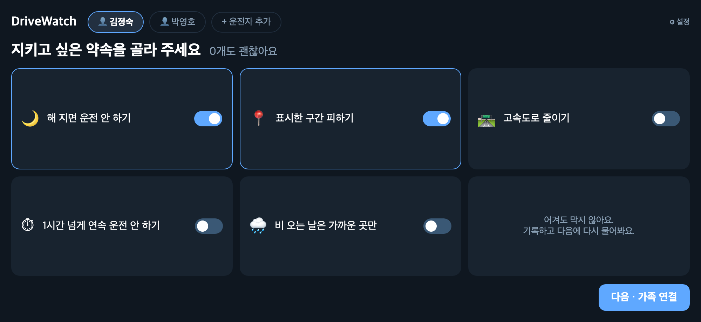

**C4 · 가족 초대 코드**

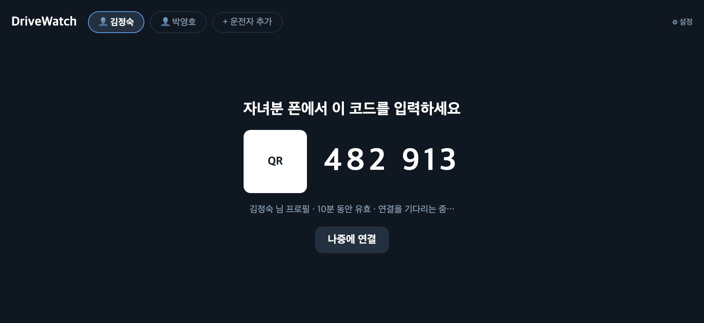

**C5 · 홈 + 시동 인사 (평소)**

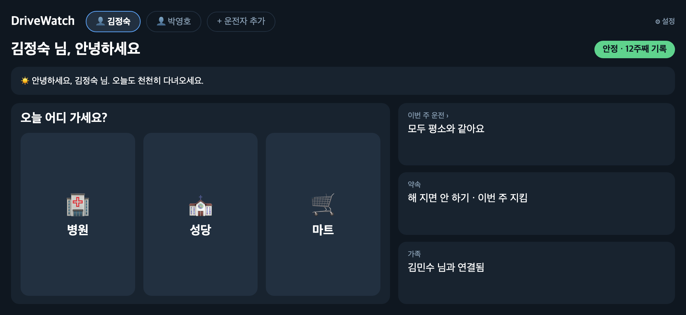

**C5 · 홈 + 시동 인사 (해 진 뒤, 시연 패널 표시)**

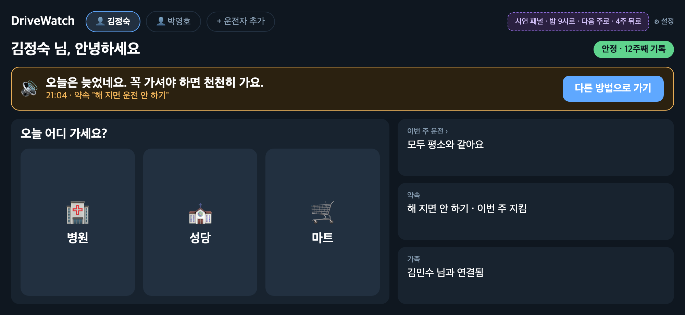

**C6 · 길 고르기**

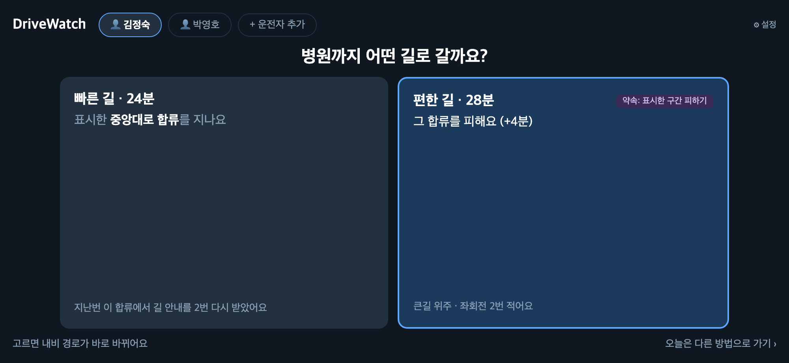

**C7 · 다른 방법으로 가기**

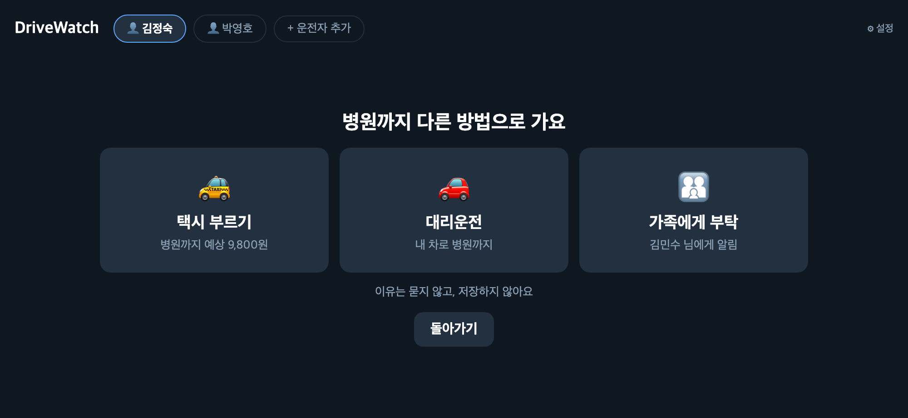

**C8 · 주행 중 토스트 (프로필 탭 잠김)**

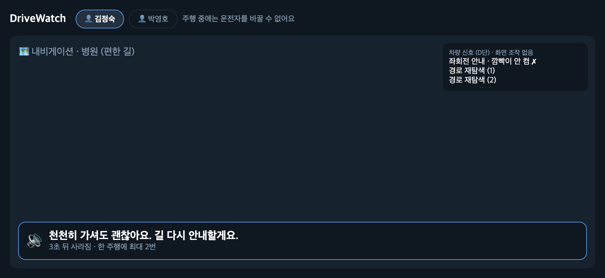

**C9 · 도착: 한 줄 + 불편했던 곳 표시**

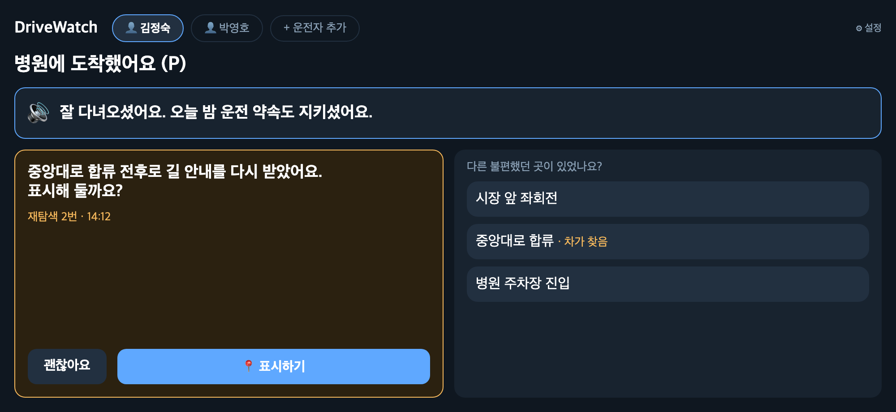

**C10 · 주간 카드 (대화 권장)**

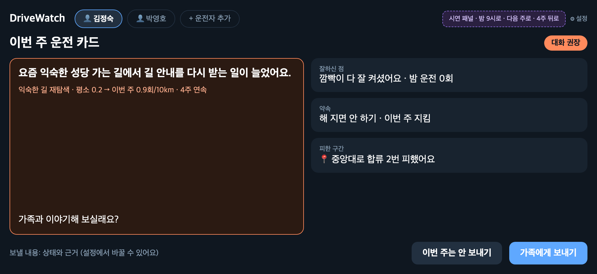

**C11 · 운전 기록 상세**

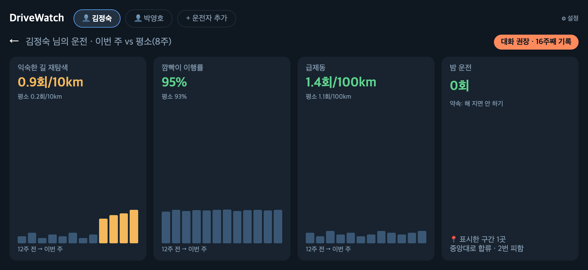

### 자녀 폰 앱

| P1 · 가입 | P2 · 부모님 차와 연결 | P3 · 연결 완료 | P4 · 가족 목록 + 알림 |
| --- | --- | --- | --- |
| 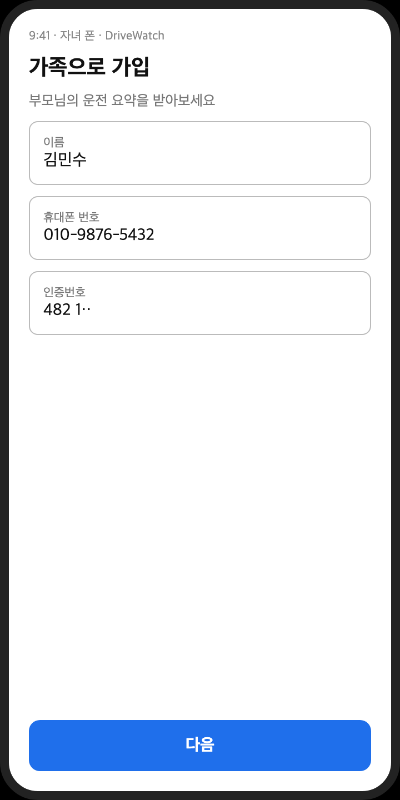 | 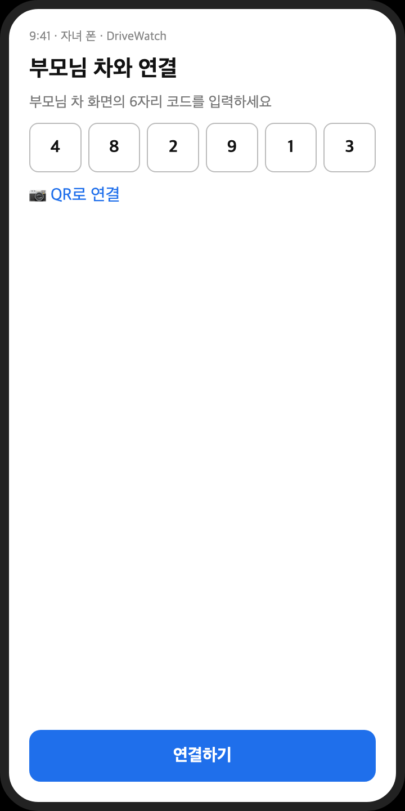 | 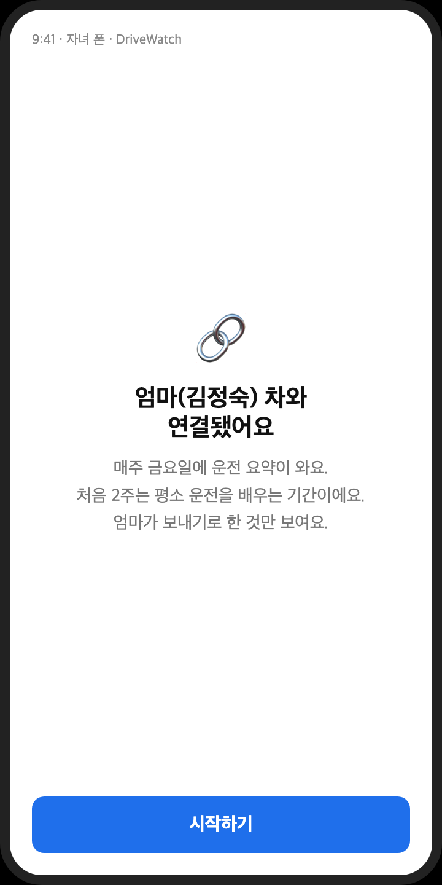 | 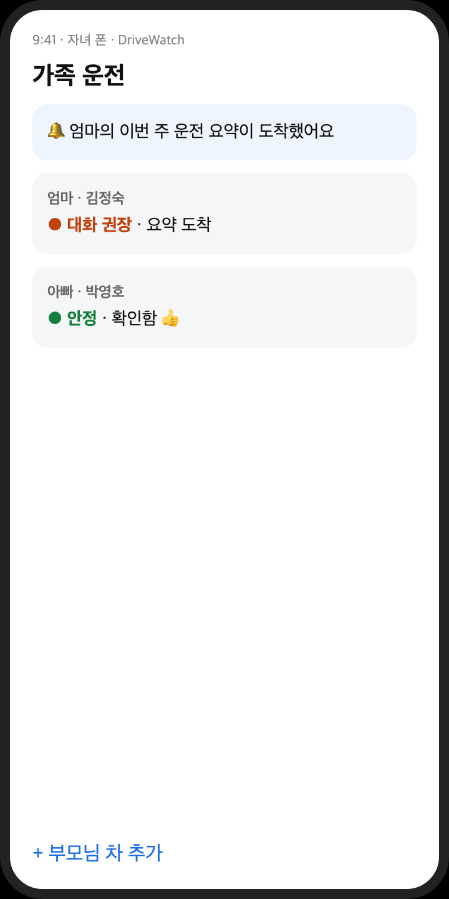 |

| 주간 요약 · 안정 | 주간 요약 · 관찰 | 주간 요약 · 대화 권장 |
| --- | --- | --- |
| 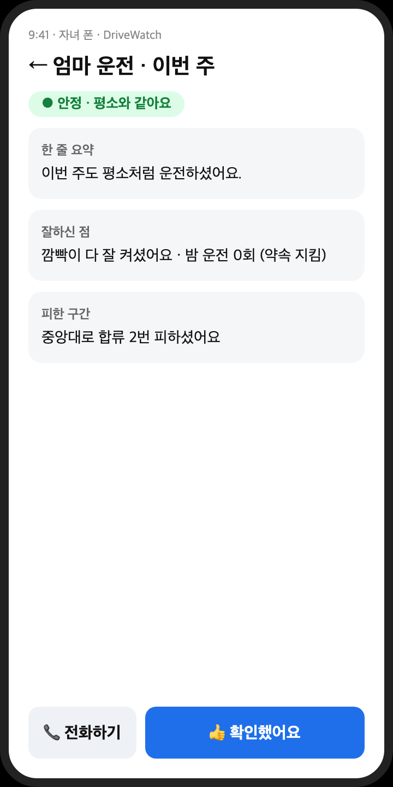 | 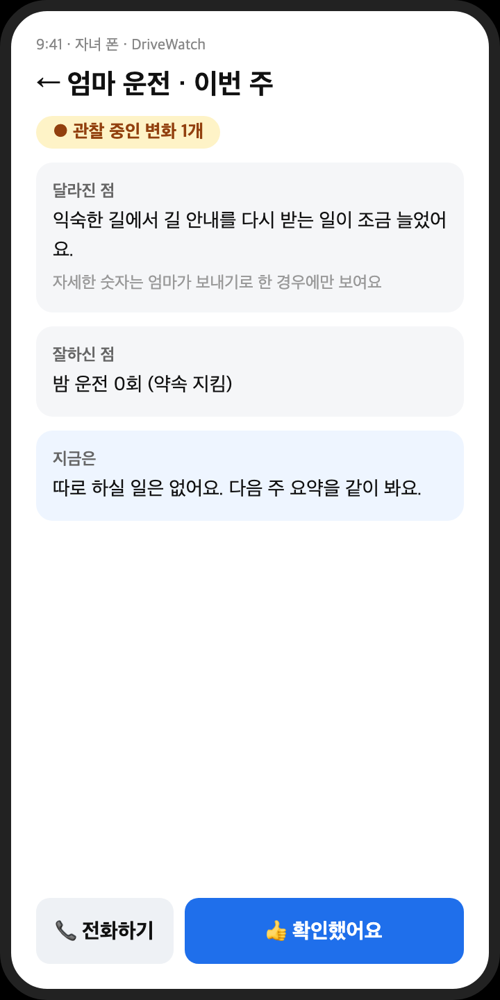 | 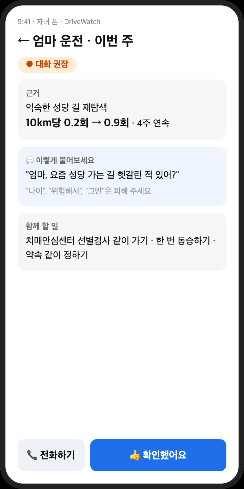 |

## 5. 새로 만들거나 고칠 화면

### C2 동의

- 제목: **"DriveWatch가 기록하는 것"**
- 기록하는 것 ✓: 익숙한 길에서 길 안내를 다시 받은 횟수, 회전할 때 깜빡이, 급제동, 밤 운전
- 기록하지 않는 것 ✗: 위치와 경로, 카메라 영상, 음주 여부
- 가족에게 보내는 범위는 둘 중 하나를 고른다.
  - `상태만` (안정 / 관찰 / 대화 권장)
  - `상태와 근거` (숫자 포함)
- 버튼: `🔊 읽어 주기` · `동의하고 시작`
- 하단 문구: "언제든 설정에서 끌 수 있어요"

### C3 약속 고르기

- 제목: **"지키고 싶은 약속을 골라 주세요"** (부제: "0개도 괜찮아요")
- 카드 5개를 켜고 끈다.
  1. 해 지면 운전 안 하기
  2. 표시한 구간 피하기
  3. 고속도로 줄이기
  4. 1시간 넘게 연속 운전 안 하기
  5. 비 오는 날은 가까운 곳만
- MVP에서 실제로 동작하는 약속은 1과 2뿐이다. 나머지는 고를 수만 있다.

### C5 홈 + 시동 인사

지금 홈(목적지 3개, 이번 주 운전 · 약속 · 가족 카드) 위에 **인사 배너** 한 줄을 넣는다. 화면을 따로 만들지 않는다.

| 상황 | 배너 | 버튼 |
| --- | --- | --- |
| 평소 | "안녕하세요, 김정숙 님. 오늘도 천천히 다녀오세요." | 없음 |
| 해 진 뒤 + 약속 1 | 🔊 "오늘은 늦었네요. 꼭 가셔야 하면 천천히 가요." | `다른 방법으로 가기` |
| 비 + 약속 5 | 🔊 "비가 와요. 가까운 곳만 가기로 하셨죠." | `다른 방법으로 가기` |
| 주간 카드 도착 (금요일) | "이번 주 카드가 왔어요" | `보기` → C10 |

### C6 길 고르기

- 표시한 구간이 있는 목적지일 때만 나온다. 없으면 고르지 않고 바로 출발한다.
- 카드 두 개를 보여준다.
  - **빠른 길 24분**: "표시한 중앙대로 합류를 지나요"
  - **편한 길 28분**: "그 합류를 피해요 (+4분)"
- 약속 2를 켰으면 편한 길을 먼저 강조한다.
- 같은 구간을 3번 피하면 다음 출발 때 묻는다: "이 합류는 앞으로도 피할까요?" → `약속으로 저장`
- 하단에 작은 버튼 `오늘은 다른 방법으로 가기`를 둔다.

### C7 다른 방법으로 가기

- 제목: **"성당까지 다른 방법으로 가요"**
- 선택지 3개:
  - `택시 부르기`
  - `대리운전`
  - `가족에게 데리러 와 달라고 하기` (연결된 가족에게 알림)
- 이유는 묻지 않고, 저장하지도 않는다.
- 시연에서는 누르면 "연결했어요 (시연용)"을 띄운다.

### C9 도착

- 🔊 한 줄: 변화가 있으면 변화 안내, 없으면 칭찬을 말한다.
  - 예: "오늘 깜빡이 다 잘 켜셨어요."
- **불편했던 곳 표시**:
  - 차가 후보를 먼저 짚어준다: "중앙대로 합류 전후로 길 안내를 다시 받았어요. 표시해 둘까요?" → `표시하기` / `괜찮아요`
  - 그 아래에 이번 주행의 회전·합류 지점 3~4개 목록을 두고, 직접 고를 수도 있게 한다.
- `가족에게 보내기`는 이 화면에서 빼서 C10으로 옮긴다.

### C10 주간 카드

부모님이 먼저 보는 카드다.

- 상태 칩: `안정` / `관찰` / `대화 권장`
- 잘하신 점 2개
  - 예: "깜빡이 다 잘 켜셨어요", "밤 운전 0회"
- 약속 이행: "해 지면 안 하기 · 이번 주 지킴"
- 피한 구간: "중앙대로 합류 2번 피했어요"
- 관찰·대화 권장 상태면 변화 한 줄과 근거를 넣는다. 대화 권장일 때는 "가족과 이야기해 보실래요?"를 덧붙인다.
- 버튼: `가족에게 보내기` · `이번 주는 안 보내기`
- 보내는 내용은 C2에서 고른 범위를 따른다.

### P5 주간 요약 (상태별)

| 상태 | 색 | 내용 |
| --- | --- | --- |
| 안정 | 초록 | 한 줄 요약 + 잘하신 점 |
| 관찰 | 노랑 | "관찰 중인 변화 1개". 근거는 부모님이 `상태와 근거`를 골랐을 때만 보인다 |
| 대화 권장 | 주황 | 근거 카드 + 대화 가이드 + 함께 할 일 (선별검사 같이 가기, 한 번 동승하기, 약속 같이 정하기) |

하단 버튼은 `👍 확인했어요`와 `전화하기`다.

## 6. 시연 순서와 시연 패널

기획서 7절의 2분 30초 순서를 화면에 맞춘 것이다. 시간을 건너뛰려면 차량 화면 구석에 **시연 패널**이 필요하다. 시연 패널은 `밤 9시로`, `다음 주로`, `4주 뒤로` 세 버튼이고, "시연용"이라고 표기한다.

| # | 장면 | 화면 |
| --- | --- | --- |
| 1 | 운전자 등록 → 동의 → 약속(해 지면 안 하기) → 초대 코드 → 자녀 폰 연결 | C1 → C2 → C3 → C4 / P1 → P2 → P3 |
| 2 | 병원 가는 길: 깜빡이 놓침, 재탐색 2회 → 🔊 "천천히 가도 돼요" | C5 → C8 |
| 3 | 병원 도착: "중앙대로 합류… 표시해 둘까요?" → 표시 | C9 |
| 4 | 시연 패널 `다음 주로` → 병원 선택 → 빠른 길 / 편한 길 → 편한 길 | C6 |
| 5 | 시연 패널 `밤 9시로` → 시동 인사 + `다른 방법으로 가기` | C5 → C7 |
| 6 | 시연 패널 `4주 뒤로` → 주간 카드(대화 권장) → 보내기 → 자녀 폰 주황 요약 → 👍 | C10 → P4 → P5 → C5 |
| 7 | 상단 탭에서 `박영호`로 바꿈 → 기록이 따로이고 상태는 안정 | C0 → C5 |

## 7. 결정 (2026-11-11 확정)

기획서와 달랐던 점을 아래처럼 정했다. 1번은 기획서 2.7·3·7절에도 반영했다.

| # | 쟁점 | 기획서 | 지금 MVP | 결정 |
| --- | --- | --- | --- | --- |
| 1 | 가족 연결 방향 | 자녀가 폰에서 초대 → 부모님이 차에서 동의 | 차가 코드를 띄우고 → 자녀가 입력 | **MVP 방식 유지 + C2 동의 화면 추가.** 부모님이 코드를 띄우는 것 자체가 동의라서 "부모님이 먼저" 원칙에 더 맞다 |
| 2 | 요약 보내는 때 | 매주 금요일 주간 카드 | 도착할 때마다 `보내기` | **주간 카드(C10)로 옮긴다.** 도착 화면은 표시 기능에 집중한다 |
| 3 | 운전자 확인 | 시동 때 시트 위치로 확인 | 상단 탭을 직접 누름 | **탭 유지.** 시트 위치 신호는 미검증이다. 탭 옆에 "시트 위치로 자동 선택 (확장)"이라고 기획서에만 적는다 |
| 4 | 가족에게 보내는 기본 범위 | 세부는 허락한 경우만 | 늘 근거까지 보냄 | **기본값 `상태만`**, C2에서 `상태와 근거`로 바꿀 수 있게 한다 |
| 5 | 시연 장소 | 병원(생활길) + 성당(재탐색 변화) | 성당만 | **둘 다 쓴다.** 병원은 표시와 편한 길, 성당은 4주 변화 |
| 6 | 내비 연동 신호 (재탐색·회전 안내) | 차량 내비 이벤트 | 시뮬레이션 | **시연 입력으로 넣고 화면에 "시연용" 표기.** 판정 엔진과 화면은 기획 지표(재탐색·깜빡이·급제동·밤 운전) 그대로 만든다. 실제 수신(NaviHelper)은 시간을 봐서 Pleos 에뮬레이터에서 확인한다 |
| 7 | 자녀 화면 | 폰 앱 | 앱 안의 폰 모양 화면 | **MVP는 웹**(`family-server`, 폰 브라우저). 제출 APK는 차량 앱 하나다. 폰 앱은 MVP 이후 |
| 8 | 주행 중 수집과 음성 | — | 액티비티에서 처리 | **포그라운드 서비스에서 처리.** D단에서 내비가 화면 앞으로 오면 화면 뒤 앱은 멈춘다([Pleos 신호 확인 기록](../docs/pleos-signal-check.md)) |
